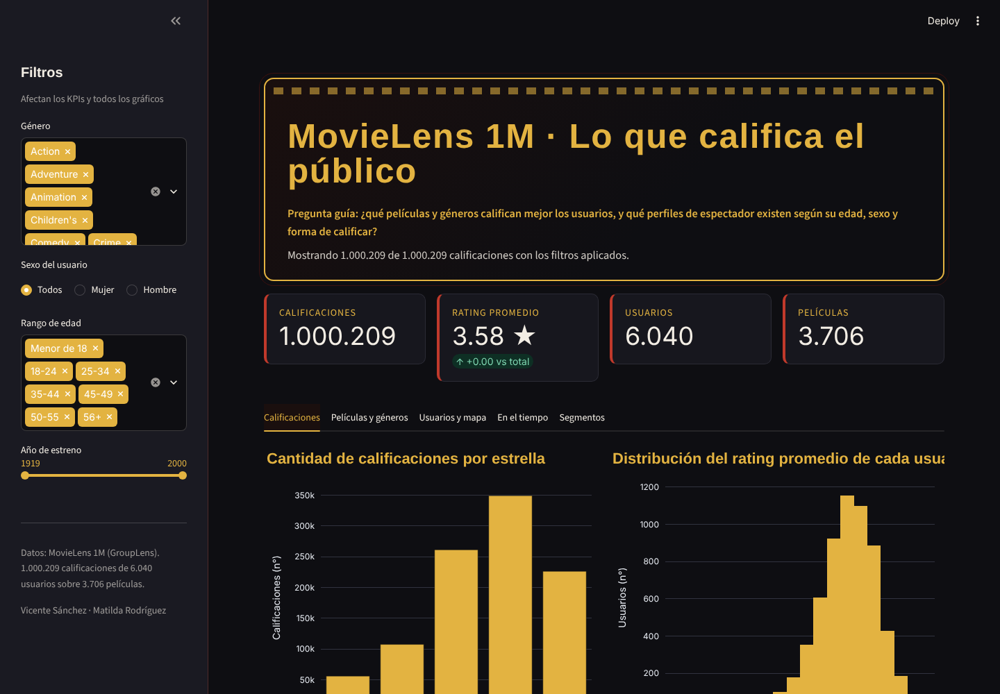

# MovieLens 1M · Lo que califica el público (v3.0.0)

Dashboard interactivo en **Streamlit + Plotly Express** sobre el dataset MovieLens 1M
(1.000.209 calificaciones de 6.040 usuarios a 3.706 películas), desarrollado para el
examen del Taller de Visualización de la Información · UDD 2026-2.

**App publicada:** [abrir el dashboard](https://tips-dashboard-38v96gu3b8qx4zzyooiuzi.streamlit.app/)

**Integrantes:** Vicente Sánchez · Matilda Rodríguez



## Pregunta que responde

Más allá del promedio, ¿qué películas y géneros valoran mejor los usuarios cuando consideramos
cuántos votos tienen y cuánto desacuerdo generan? (misma pregunta del Certamen 2)

## Contenido

- **Filtros globales (4)** en el panel lateral: género, sexo, rango de edad y año de estreno.
  Si dejan la tabla vacía, la app avisa y se detiene (`st.stop()`).
- **KPIs (4)** con `st.metric`: calificaciones, rating promedio (con delta vs. el total),
  usuarios y películas.
- **Pestañas:** Calificaciones · Películas y géneros · Usuarios y mapa · En el tiempo · Segmentos.
- **Gráficos obligatorios:** coordenadas paralelas con color continuo, treemap y sunburst
  (path y values), coropleta por estado con GeoJSON (`data/us-states.geojson`) y radar
  (`px.line_polar`, `line_close=True`). Todos los gráficos tienen tooltips personalizados.
- **Análisis univariado, temporal y de relaciones:** distribución de estrellas, histograma del
  promedio por usuario, rating por año de estreno, calificaciones por mes y popularidad vs. calidad.
- **Controles locales:** mínimo de calificaciones del Top 10, variable de color del mapa y
  selector de segmento.
- **Segmentación de películas (igual que el Certamen 2):** K-Means con k = 3 (método del codo)
  sobre promedio, votos y dispersión escalados, solo películas con 20 votos o más. Segmentos:
  Alta exposición, Valoración favorable y Menor valoración, con dispersión por segmento, radar,
  tabla de perfiles, selector de segmento y coordenadas paralelas.
- **Hallazgos principales** escritos al final de la página y tabla de datos filtrados en un
  `st.expander`.

## Datos

Archivos originales de MovieLens 1M en `data/` (`ratings.dat`, `users.dat`, `movies.dat`),
los mismos del Certamen 2, cargados con `@st.cache_data`. El estado de EE.UU. se obtiene de
los 3 primeros dígitos del código postal; 18 usuarios con códigos no válidos o de fuera de
EE.UU. quedan fuera del mapa.

## Ejecutar en local

```bash
pip install -r requirements.txt
streamlit run tips_app.py
```

## Cambios desde la beta (v2.1.0-beta → v3.0.0)

- Gráficos organizados en pestañas (retroalimentación del Hito 1).
- Diseño con temática de cine: tema oscuro, paleta dorado/rojo, tipografía de marquesina.
- Se agregaron los gráficos que faltaban según la pauta: coordenadas paralelas, treemap,
  coropleta con GeoJSON, radar, dispersión, histograma, mapa de calor y serie mensual.
- Segmentación de películas del Certamen 2 llevada al dashboard: dispersión, radar, tabla de perfiles y selector.
